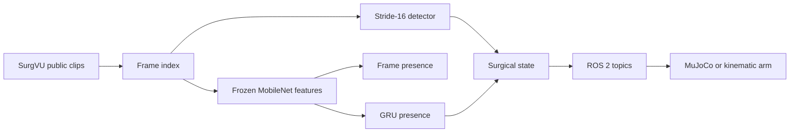

# Architecture

Clips go to a frame index. A stride-16 detector and a frozen MobileNet pool read those frames. The pool feeds a linear presence head and a GRU. Detections and presence become one state. ROS 2 carries that state to a two-link arm.

## Perception

`ToolDetector` keeps `mobilenet_v3_small` `features[:6]` (stride 16, 40 channels) and a small conv head: objectness, class, one box. At the 256×320 training size the grid is 16×20. On these clips, no two ground-truth boxes land in the same cell.

The trunk starts from ImageNet weights and is fine-tuned with the head. A second, frozen MobileNet pool (576-d) is only for presence. The recorded runs kept the augmented detector (higher validation mAP) and the 16-frame GRU (higher validation macro-F1). See `docs/research.md`.

A COCO Faster R-CNN with a MobileNet-V3-320 FPN took about 4 to 7 seconds per training step on this machine, so it was not trained. Detection metrics use the 320×256 boxes. Overlays multiply them back onto the 640×512 frame.

## Context and the arm

`SurgicalState` is a dataclass: time, clip, frame, tools, presence, confidence, uncertain flag, events, a short history, and optional latency. Confidence is the minimum of the top detection score and the temporal probability of that class. The threshold file from the validation sweep is 0.35.

`/surgical/perception`, `/surgical/context`, and `/surgical/assistant` are best-effort `std_msgs/String` topics. The nodes are separate processes. CycloneDDS is bound to `lo0` (`ros2/cyclonedds.xml`).

The arm is the MuJoCo model in `surgisense.sim` when that package imports. Otherwise `integrate` holds or steps the same two joints, and the trajectory file names the backend. A hold zeros joint velocity and leaves the position alone.
